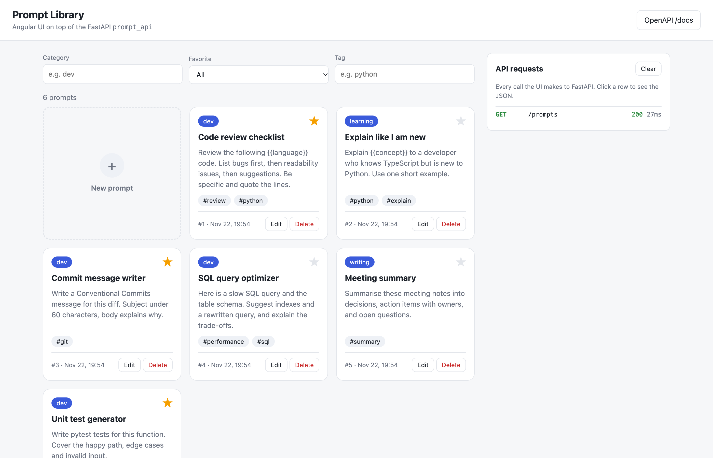
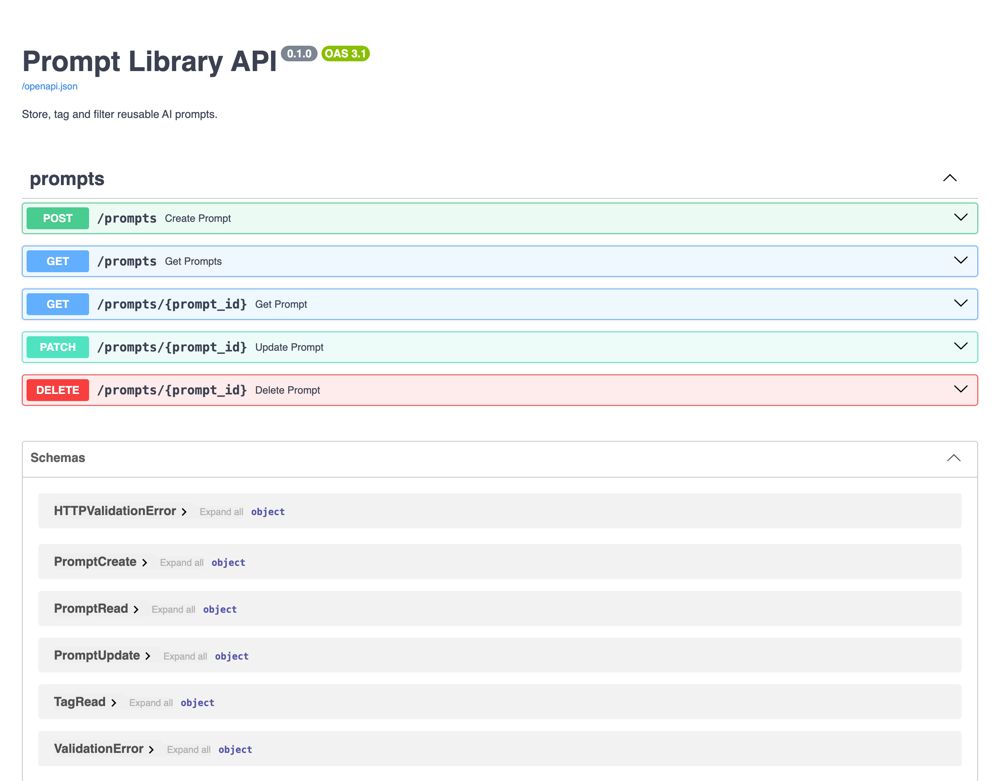
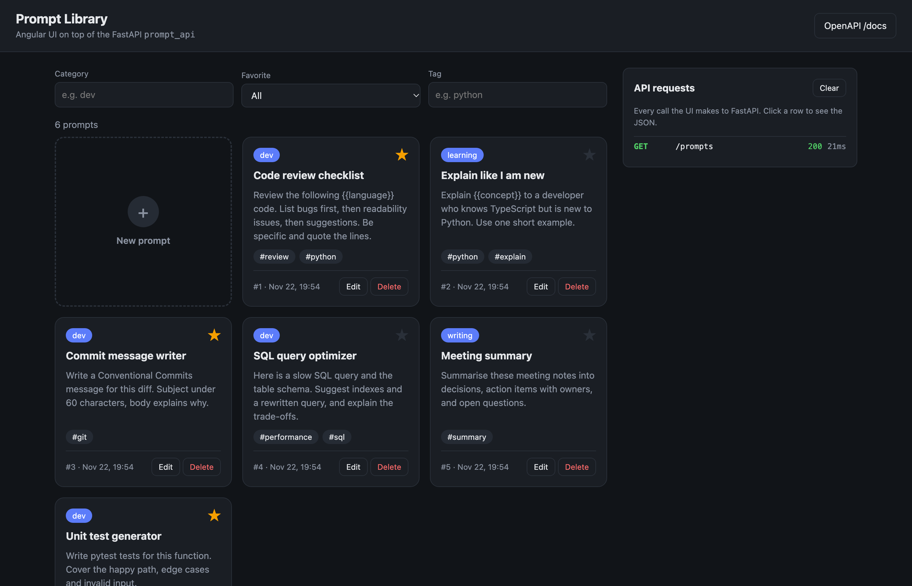
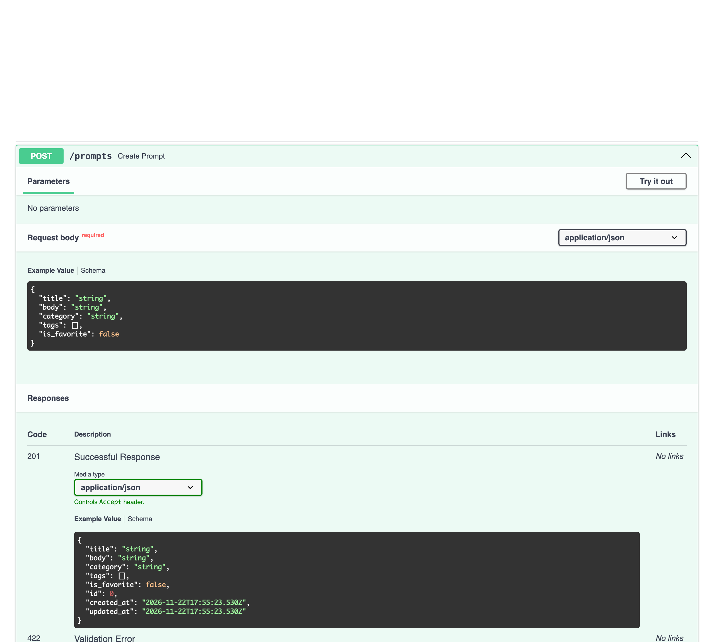

# Prompt Library

[](https://github.com/olshevskyi/prompt-library/actions/workflows/ci.yml)


A small full-stack app for storing, tagging and filtering reusable AI prompts.

- **`api/`**: REST API on FastAPI, SQLAlchemy 2.0 and SQLite, validated with Pydantic and covered by pytest.
- **`ui/`**: Angular 21 client that talks to the API and shows every HTTP call it makes.



## Features

- Full CRUD for prompts: `POST`, `GET`, `PATCH` (partial update), `DELETE`
- Filtering by category, favorite flag and tag via query parameters
- Tags as a real many-to-many relation (`prompts` ↔ `prompt_tags` ↔ `tags`), created on first use
- Input validation with clear `422` errors, `404` for unknown ids
- Interactive OpenAPI docs at `/docs`
- 12 API tests against an isolated in-memory database, run in CI on every push

## Quick start

You need [uv](https://docs.astral.sh/uv/) and Node.js 22+.

```bash
# terminal 1: API on http://127.0.0.1:8000
cd api
uv sync
uv run fastapi dev app/main.py

# terminal 2: UI on http://localhost:4300
cd ui
npm install
npm start
```

The UI proxies `/api/*` to the API (`ui/proxy.conf.json`), so no CORS setup is needed.

## API

| Method | Path | Description |
|--------|------|-------------|
| `POST` | `/prompts` | Create a prompt (201) |
| `GET` | `/prompts` | List prompts, filter with `?category=`, `?favorite=`, `?tag=` |
| `GET` | `/prompts/{id}` | Get one prompt (404 if missing) |
| `PATCH` | `/prompts/{id}` | Update only the fields that are sent |
| `DELETE` | `/prompts/{id}` | Delete a prompt (204) |

More details and examples are in [api/README.md](api/README.md).



## Repository layout

```
prompt-library/
├── api/                 FastAPI backend
│   ├── app/
│   │   ├── main.py      app instance, router registration
│   │   ├── database.py  engine, session, get_db dependency
│   │   ├── models.py    SQLAlchemy tables
│   │   ├── schemas.py   Pydantic request/response models
│   │   ├── crud.py      database operations
│   │   └── routers/     HTTP endpoints
│   └── tests/           pytest suite
├── ui/                  Angular client
├── docs/screenshots/
└── .github/workflows/   CI
```

## Screenshots

| Light | Dark |
|-------|------|
|  |  |

<details>
<summary>Swagger: POST /prompts</summary>



</details>
