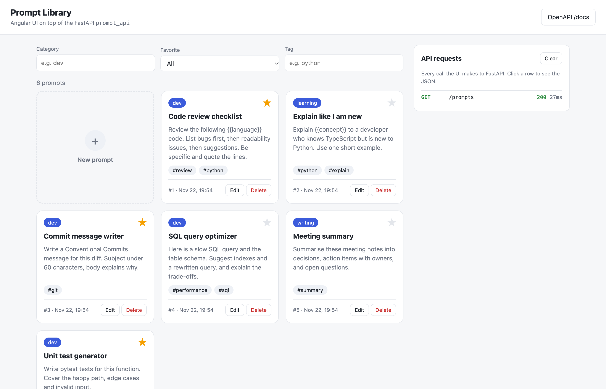

# Prompt Library UI

Angular 21 client for the FastAPI backend in [`../api`](../api).
It uses standalone components, signals, the new control flow and reactive forms.



## Run

1. Start the API (terminal 1):
   ```bash
   cd ../api
   uv run fastapi dev app/main.py
   ```
2. Start the UI (terminal 2):
   ```bash
   npm install
   npm start
   ```
3. Open http://localhost:4300

Requests to `/api/*` are proxied to `http://127.0.0.1:8000` (see `proxy.conf.json`),
so the backend needs no CORS setup.

## What it shows

- A card grid with a "New prompt" tile, plus a create/edit drawer
- Filters by category, favorite and tag, mapped to `GET /prompts` query params
- A star toggle that sends a single-field `PATCH`, which is exactly what `exclude_unset` exists for
- FastAPI `422` validation errors rendered next to the form
- An **API requests** panel: an HTTP interceptor logs every call with status,
  timing and the request/response JSON

## Structure

- `src/app/core/prompt.model.ts`: TypeScript interfaces mirroring `api/app/schemas.py`
- `src/app/core/prompt-api.service.ts`: one method per endpoint in `api/app/routers/prompts.py`
- `src/app/core/api-log.ts`: interceptor and signal store for the requests panel
- `src/app/app.*`: list, filters, editor drawer
